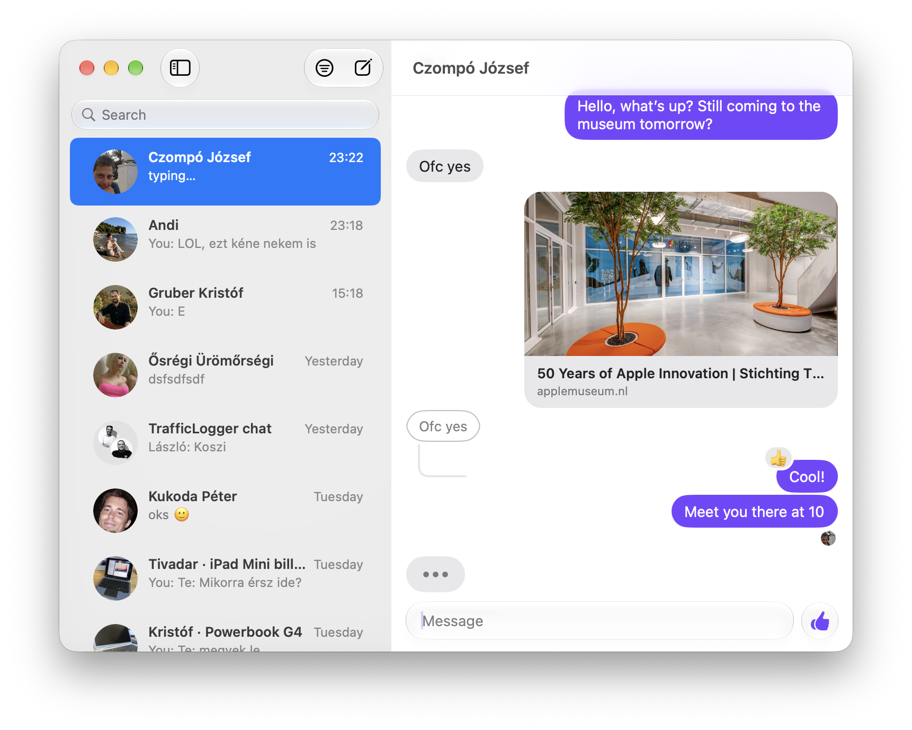

# Hermes

An unofficial, learning-purpose macOS client for Facebook Messenger with a native AppKit UI modeled on Apple's Messages.

> **Not affiliated with Meta.** This is an independent project. It is not made, endorsed or supported by Meta Platforms, Inc. Facebook, Messenger and their logos are trademarks of Meta Platforms, Inc.

<p align="center"></p>

## Download

**[Download the latest version](https://github.com/gklka/Hermes/releases/latest)** (`Hermes-<version>.dmg`, under Assets). It needs macOS 26 or later, on an Apple silicon or Intel Mac.

1. Open the DMG and drag Hermes to Applications.
2. Open Hermes. It isn't notarized, so macOS blocks it the first time: go to **System Settings › Privacy & Security** and click **Open Anyway** next to the Hermes message.
3. Log in with your Facebook account. To see your encrypted chats' history, choose **Restore Encrypted Chats…** and enter your Messenger PIN once.

After that, Hermes updates itself: it checks daily, or choose **Hermes › Check for Updates…**. Read [Before you use it](#before-you-use-it) first.

## Features

### A real Mac app

No Electron and no web page in a window. Hermes is written in Swift with AppKit, and looks and behaves like Apple's Messages:

- **Native UI:** Liquid Glass toolbar and compose field, a source-list sidebar, Messages-style bubbles, tapbacks and read pictures.
- **Mac conventions:** full menus and keyboard shortcuts (⌘1–⌘9 pick a chat, ⌘F, ⌥⌘F Find in Chat, ⌘E Edit, ⌘L Like…), chats in their own windows, drag and drop, Quick Look, Copy Image and Save to Downloads, three-finger swipes between chats, a Dock badge and Dock menu.
- **System integration:** notifications with Reply and Mark as Read, an incoming call banner like a system notification, Shortcuts actions, messages in Spotlight, a Share extension, and contact cards from your Contacts.
- **Smooth animations:** arriving messages, the typing bubble turning into the message, rows sliding, read pictures moving, and poll votes.
- **Light and dark mode,** and each chat's Messenger theme colors.
- **Fast:** messages are stored locally, so chats open instantly.
- **Updates itself** from the GitHub releases (Hermes › Check for Updates…).

### Messenger

- 1:1, group and end-to-end encrypted chats, with live sync and full history.
- Text, replies, pictures and files, link previews, tapbacks and quick reactions.
- Tag people with @ in group chats.
- Edit (with earlier versions) and unsend, typing indicators, read receipts and presence.
- **Polls** in group chats, like in Messages: make one from the + menu (its choices right in the message field), and vote by clicking the options' bubbles, which grow with their votes and show who voted. Several choices are allowed, and you can add choices.
- **Audio and video calls,** made and answered through Messenger's web app, with call cards in the chat (Call Back, and when a missed call was).
- **Message requests:** Messenger's You May Know and Spam lists, with Accept, Delete and Block.
- Shared posts, reels and stories as rich cards, and shared locations.
- Find in Chat (also fetching older history) and Export Chat as Markdown.
- Start chats with anyone on Messenger, see a group's members, mute, mark read or unread, delete, leave and block.
- Encrypted chats' history and themes, read from Messenger's own web app once you've restored it with your PIN.

### What Hermes will never have

Hermes is for messaging. These won't be added, ever:

- **Meta AI:** no AI chats, AI suggestions or AI features.
- **Ads:** no ads or sponsored messages, and no promoted content.
- **Chat heads:** no floating bubbles over other apps. Chats stay in their windows.
- **Stories:** no viewing or posting stories. Stories shared in a chat still show as cards there.
- **Meta profile management:** no editing your profile, account or privacy settings. Use facebook.com for that.

**Hermes is free and will always remain completely free:** no paid version, no subscriptions, no in-app purchases.

## Before you use it

- **It may break Facebook's Terms.** Meta's [Terms of Service](https://www.facebook.com/terms.php) don't allow accessing their products by automated means or with unofficial tools without their permission. Meta can restrict, suspend or disable an account it believes breaks its terms.
- **Your account is your responsibility.** Use it only with an account you're willing to risk. Nothing here is a promise that it's safe to use.
- **No warranty.** It's provided as is (see the license): it can stop working at any time if Meta changes its service, lose or misshow messages, or fail to deliver them. Don't rely on it for anything important.
- **Your data stays on your Mac.** Messages, keys and session cookies are stored in `~/Library/Application Support/Hermes/` and go only to Meta's servers. Keep that folder private: anyone with it can use your session.

## How it works

```
AppKit UI (App/)  ──JSON over C calls──▶  Go core (Core/, static lib)
                                          ├─ messagix  → facebook.com web protocol (MQTT/LightSpeed over WebSocket)
                                          └─ whatsmeow → end-to-end encrypted chats (Signal protocol)
```

- **Login:** a WKWebView shows facebook.com's own login page. Once the `c_user` and `xs` cookies exist, they're passed to the core.
- **Core:** it uses [mautrix-meta](https://github.com/mautrix/meta)'s `messagix` package as a library and stores threads and messages in `~/Library/Application Support/Hermes/app.db`. E2EE keys are in `e2ee.db`, and logs are in `core.log`.
- **Bridge:** Swift calls `MMRequest(json)`, and Go replies through one callback with `{"type":"response"|"event", …}`. See `App/Core/CoreBridge.swift`, `Core/main.go` and `Core/rpc.go`.
- **Encrypted history:** Messenger keeps it in a PIN-protected backup. A hidden web view runs Messenger's own web app, where you restore it once; the app reads the history and themes from there.
- **Calls:** Meta's calling has no open implementation, so calls run in Messenger's web app, in their own window; the app clicks its call buttons and mirrors its incoming call dialog.

## Building

Requires Xcode 26+ and Go (`brew install go`).

1. Create `Support/Signing.local.xcconfig` with your own bundle ID prefix and Apple developer team (see `Support/Signing.xcconfig`).
2. Build the `Hermes` scheme. The "Build Go Core" phase runs `Support/build-core.sh`, which produces `Core/build/libmmcore.a` before Swift compiles.
3. `Support/install.sh` builds Release and installs it to `/Applications` (Shortcuts and Spotlight need the installed, team-signed copy).

See `HANDOFF.md` for the architecture and the file layout.

## Limitations

- Calls depend on Messenger's web app.
- Polls can't be made in encrypted chats (Messenger's web app can't either).
- Siri can't send messages (Apple's messages schema didn't hand the app a recipient).
- Encrypted history comes from the web app, 400 messages at a time (more as you scroll up), so it's slow to go far back.
- It isn't notarized (there's no Developer ID): the first launch needs System Settings › Privacy & Security › Open Anyway.

## License

Hermes is free software, licensed under the [GNU Affero General Public License v3.0](LICENSE) (AGPL-3.0). It has to be: it's built on [mautrix-meta](https://github.com/mautrix/meta), which is AGPL-3.0. If you distribute it or a modified version, you must make the source available under the same license.

It also uses [whatsmeow](https://github.com/tulir/whatsmeow) and [go.mau.fi/util](https://github.com/mautrix/go-util) (Mozilla Public License 2.0), and other Go modules under their own licenses (see `Core/go.mod`). Updates use [Sparkle](https://sparkle-project.org) (MIT License).

This program is distributed in the hope that it will be useful, but WITHOUT ANY WARRANTY; without even the implied warranty of MERCHANTABILITY or FITNESS FOR A PARTICULAR PURPOSE. See the GNU Affero General Public License for more details.
